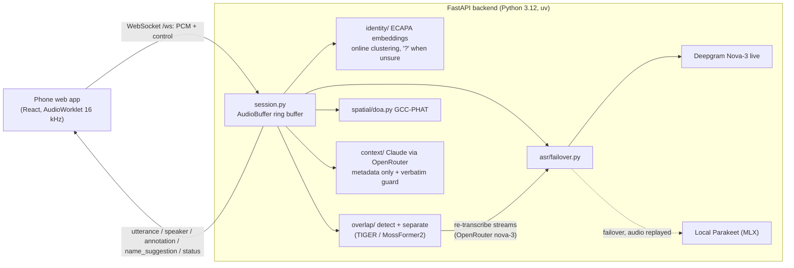

# Voxli

Live captions for group conversations, built for Deaf and hard-of-hearing (DHH) people. Open it on a phone, put the phone on the table, and read who is saying what, as they say it.

What makes it different from plain live captioning:

- **Consistent speaker identities.** Voice embeddings (ECAPA) keep "Speaker A" the same person all session. When the system is not sure, the line shows a **?** instead of a confident wrong name.
- **Overlap separation.** When two people talk at once, the overlapping span is separated into two streams and both contributions are shown side by side, instead of one being dropped.
- **Direction.** If the phone delivers true stereo, the radar ring shows roughly where each voice comes from. (iPhone Safari currently delivers duplicated mono; the app detects this and says so.)
- **Conversation structure from Claude.** Claude (via OpenRouter) adds metadata only: who replied to whom, interruptions, threads, unfinished sentences, and names learned from introductions ("I'm Sarah"). It **never rewrites words**: caption text is always verbatim ASR output, enforced by a guard that rejects any model output that touches text.
- **Catch me up + type-to-speak.** Verbatim lines first, with a labelled AI summary; reply by typing (spoken aloud by the phone), quick phrases, or AI-suggested replies that are never sent automatically.
- **Keeps working when things fail.** Deepgram unavailable -> automatic on-device Parakeet fallback with no lost captions; mono mic -> clear banner; low confidence -> "?" badge.

> **Honesty note:** all test audio in this repository is **synthetic** (macOS `say` text-to-speech voices, mixed by `backend/scripts/make_clips.py`). It is cleaner and easier than real speech. See `docs/EVIDENCE.md` for exactly what was and was not tested.

## Architecture



Wire format and module interfaces: `docs/CONTRACT.md`.

## Setup

Requirements: macOS on Apple Silicon (local ASR fallback uses MLX), Python 3.12 + [uv](https://docs.astral.sh/uv/), Node 20+, ffmpeg (test clips only).

1. Keys: create `.env` in the repo root (never commit it; it is gitignored):
   ```
   OPENROUTER_API_KEY=...
   DEEPGRAM_API_KEY=...
   ```
2. Backend deps: `cd backend && uv sync`  (first run downloads models into `backend/models_cache/` / the Hugging Face cache).
3. Web deps: `cd web && npm install`
4. Run both: `./dev.sh` and open the printed `https://<LAN-IP>:5173` **on the phone**.
   - The dev server uses a **self-signed HTTPS certificate** because phone browsers only allow the microphone on HTTPS. Accept the warning once.
   - Phone and computer must be on the same Wi-Fi.
5. No backend? `https://<LAN-IP>:5173/?mock=1` plays a scripted fake conversation (UI demo only).

Tests and evidence scripts (from `backend/`):

```
uv run pytest
uv run python scripts/make_clips.py      # regenerate synthetic clips -> eval/clips/ (+ manifest.json)
uv run python scripts/eval_asr.py        # ASR comparison -> eval/out/asr.md
```

Other evaluation scripts are listed in `docs/EVIDENCE.md`.

## Privacy model

- **Audio leaves the device.** In normal mode the microphone audio is streamed to **Deepgram** (cloud ASR). Short overlapping spans may be sent to **OpenRouter** for re-transcription. **Transcript text** (not audio) is sent to Claude through OpenRouter for conversation structure. If Deepgram is unreachable the app falls back to on-device Parakeet; there is no fully offline mode for the Claude features (they simply stop).
- **No raw audio is written to disk** by the app. (Only the synthetic test clips under `eval/` are files.)
- **Voiceprints are opt-in.** Voice memory is off by default. When on, only embeddings and names are stored in a local JSON file (never audio). "Delete everything" in settings wipes speakers, voiceprints, and history (`forget_all`).
- Speaker names are only set by the user, by a self-introduction (auto-applied, undoable), or as a suggestion the user must confirm.
- API keys live only in the server-side `.env`; the browser never sees them.

## Limitations (stated up front)

- Evaluated on **synthetic TTS speech** and a handful of clips; no tests with real DHH users, and no real-room recordings. Real-world accuracy will be lower.
- Voice identity can confuse similar voices or very short utterances; that is why uncertain labels show "?".
- Overlap separation is best-effort on spans up to a few seconds with two voices; it is not a hearing aid and does not handle 3+ simultaneous voices.
- Direction needs a device that exposes real stereo microphones; many phones/browsers give duplicated mono.
- Needs internet for best quality (Deepgram + Claude features). The on-device fallback refreshes interim text about every 0.6 s but was less complete in our test (see `docs/EVIDENCE.md` section 3), and the Claude features need internet.
- Claude summaries and reply suggestions are AI-generated and labelled as such; they can be wrong.
- Not a replacement for professional interpreters or CART in high-stakes settings (medical, legal).

## Credits and licenses of third-party components

Licenses below were read from each model's Hugging Face card on 2026-11-24; confirm before redistribution.

| Component | Use | License |
|---|---|---|
| Deepgram Nova-3 (service) | live ASR, overlap re-transcription via OpenRouter | commercial API terms |
| NVIDIA Parakeet-TDT 0.6B v3 / `mlx-community` MLX port, `parakeet-mlx` | on-device ASR fallback | CC-BY-4.0 (model); see package for code license |
| SpeechBrain `spkrec-ecapa-voxceleb` | speaker embeddings | Apache-2.0 |
| TIGER speech separation (`JusperLee/TIGER-speech`), vendored code in `backend/vendor/tiger_sep` | overlap separation | Apache-2.0 (weights card); see vendored LICENSE |
| MossFormer2 (ClearerVoice-Studio), vendored in `backend/vendor/mossformer2_ss` | overlap separation (compared) | see vendored LICENSE |
| pyannote segmentation | overlap detection | MIT (gated weights: requires accepting terms on Hugging Face) |
| Silero VAD | local ASR chunking | MIT |
| Anthropic Claude Haiku / Sonnet via OpenRouter | conversation structure | API terms |
| macOS `say` voices | synthetic test clips only | Apple system voices, not redistributed in the app |

Built for the Global AI Builder's Challenge 2026.
